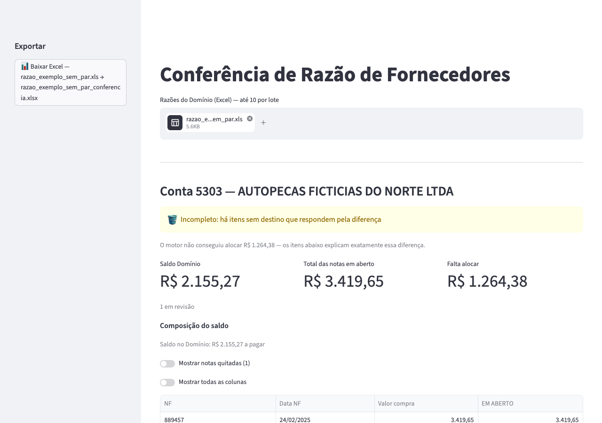
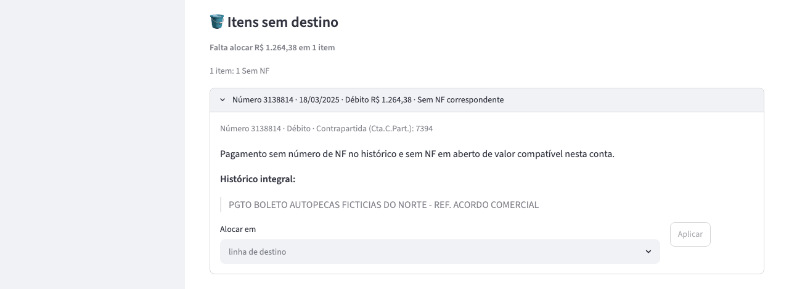
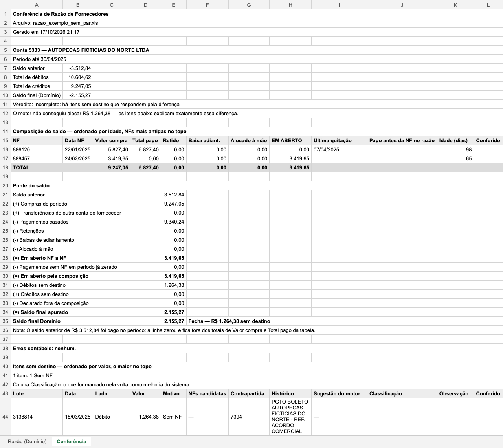
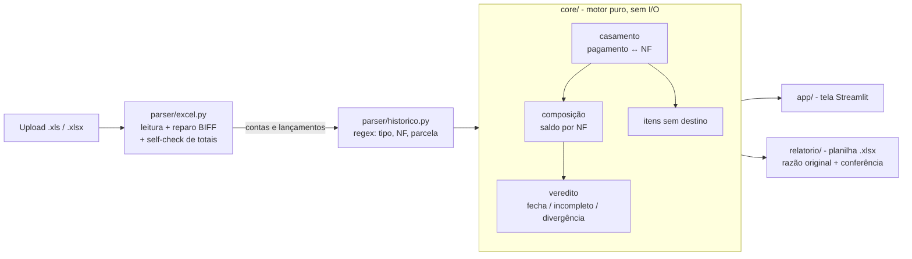

# Conciliador de Razão de Fornecedores



Confere a razão de fornecedores exportada do sistema contábil Domínio: liga cada pagamento à nota fiscal que ele
quita, compõe o saldo em aberto nota a nota e diz se a composição bate com o saldo final da conta. O que o motor não
consegue decidir com certeza vai para uma lista de itens sem destino, nunca para um palpite.

Python 3.13 · Streamlit · Excel `.xls` (com reparo do arquivo) e `.xlsx` · `Decimal` · pytest · Docker.
Todos os dados do repositório são sintéticos: empresas e fornecedores com "FICTICIA" no nome, CNPJ
00.000.000/0000-00, notas, valores e históricos inventados.

## Como rodar

```bash
git clone https://github.com/leirosjose/conciliador-razao.git
cd conciliador-razao
docker compose up
```

Abra http://127.0.0.1:8501 e envie `exemplos/razao_exemplo_sem_par.xls`.

Sem Docker (Python 3.11 ou mais novo):

```bash
python3 -m venv .venv
.venv/bin/pip install -r requirements.txt
.venv/bin/streamlit run app/main.py --server.address 127.0.0.1 --server.headless true
```

## O exemplo

`exemplos/razao_exemplo_sem_par.xls` é uma razão de uma conta no layout do Domínio, com 7 lançamentos. Ao enviá-la, a
tela mostra:

- veredito **Incompleto**: a composição não bate com o saldo, e a diferença está explicada;
- **Total das notas em aberto R$ 3.419,65** (NF 889457, sem pagamento) × **Saldo Domínio R$ 2.155,27**;
- **Falta alocar R$ 1.264,38** = exatamente **1 item sem destino**: um boleto pago sem número de nota e com valor
  que não é parcela de nota nenhuma. O motor não o encaixa à força; ele fica para quem confere decidir;
- a NF 886120 quitada por duas parcelas que citam o número, e o saldo anterior quitado pela nota antiga.



A mesma conferência sai numa planilha `.xlsx` com duas abas: a razão original, copiada fiel dos bytes enviados, e a
conferência, com os mesmos números da tela.



## O que o projeto mostra

| Tema | Onde |
|---|---|
| Leitura de Excel: `.xls` BIFF (com reparo do defeito do exportador) e `.xlsx`, roteados pela assinatura do arquivo | `parser/excel.py` |
| Expressões regulares sobre o histórico do lançamento | `parser/historico.py` |
| Motor de casamento pagamento ↔ nota (por número, por soma de notas, por valor) | `core/casamento.py` |
| Dinheiro sempre em `Decimal`, nunca `float` | `parser/`, `core/` |
| Camadas: motor puro sem I/O; leitura, tela e planilha como cascas | `core/`, `parser/`, `app/`, `relatorio/` |
| Testes com golden sintético e 6 cenários com resultado declarado | `tests/`, `tests/GOLDEN.md` |
| Docker (usuário não-root, healthcheck, porta só local) | `Dockerfile`, `compose.yaml` |
| Integração contínua: ruff, pytest e build da imagem | `.github/workflows/ci.yml` |

## Arquitetura



- `core/` não conhece arquivo, tela nem planilha: recebe lançamentos e devolve composição, itens sem destino e
  achados. Por isso é testado sem Excel e sem navegador.
- O vocabulário do histórico mora em `parser/historico.py`, fora do motor: um padrão novo é uma linha numa lista,
  não código no core.
- A tela (`app/`) e a planilha (`relatorio/`) não recalculam a composição: totais, saldo e diferença chegam prontos do
  motor. A única conta da casca é a materialidade (quanto os maiores itens sem destino pesam na diferença), isolada em
  `app/materialidade.py` e sem efeito em nenhum número da composição. As duas usam as mesmas funções de texto: a
  planilha nunca diverge da tela.

## Decisões

- **`Decimal` de ponta a ponta.** A tolerância de centavos do casamento é uma regra explícita, não um efeito do
  arredondamento.
- **Nunca forçar a composição a fechar.** Se a soma não bate com o saldo, o veredito diz e mostra a diferença.
- **Casamento em ordem fixa, do mais seguro para o menos:** número da nota no histórico; pagamento que cita várias
  notas e paga a soma delas (se paga acima, as notas citadas quitam e a sobra vira uma linha própria, identificada);
  por valor, só quando é inequívoco (pagamento único igual à nota, ou uma de N parcelas iguais). Quando mais de uma
  nota comporta o pagamento, há um desempate explícito: a única ainda em aberto ou a de emissão mais antiga, sempre
  com marcador na linha. Só o empate que sobra (mesmo valor e mesma data) vai para os itens sem destino.
- **Conferir a leitura.** Totais de débito e crédito, saldo final e saldo corrente linha a linha são conferidos contra
  o que a própria razão declara. Se não batem, o veredito é **Divergência**, com o esperado e o encontrado; nada é
  ajustado para fechar. Um arquivo reparado que não bate é recusado.
- **Entrada em Excel.** É o formato estruturado que o Domínio exporta; o sistema não lê PDF.
- **A tela mostra fatos.** Sem instrução ao usuário e sem citar pessoa; um teste varre os textos da tela e da
  planilha (`tests/test_regra_de_tela.py`).
- **Golden sintético.** `tests/fixtures/golden_sintetico.xls` tem a forma de uma razão de verdade (12 lançamentos,
  2 notas em aberto com pagamentos parciais, artefato de float na composição manual) com dados inventados; o
  esperado de cada caso está em `tests/GOLDEN.md`. As planilhas de teste saem de um gerador determinístico
  (`tests/fixtures/gerar_sinteticas.py`): rodar duas vezes gera os mesmos bytes.

## Problemas reais e como resolvi

**O Excel do Domínio que não abre.** Alguns `.xls` saem do exportador com o ponteiro da planilha (record BOUNDSHEET)
apontando para um bloco de células vazias órfãs, e o `xlrd` falha com `Expected BOF record`. O parser extrai o stream
BIFF do container OLE, realinha cada ponteiro ao início real da planilha e reabre. Como reparar um arquivo pode
esconder um defeito, a leitura reparada passa pelo mesmo self-check de totais: se não bater, o arquivo é recusado.
Os testes usam um `.xls` corrompido do jeito exato que o exportador corrompe (o gerador aplica o inverso do reparo) e
um adulterado que repara mas não fecha.

**`Decimal` × `float`.** As células trazem dinheiro como ponto flutuante, e a composição feita à mão no Excel carrega
artefatos como `1440.090000000001`. Todo valor entra como `Decimal(str(valor))` arredondado ao centavo, e nenhuma
conta de dinheiro passa por `float`. Na aba da razão original da planilha exportada o número cru fica como está:
cópia fiel é cópia fiel.

**Regex sobre um histórico escrito à mão.** O histórico é texto livre: `PAGTO REF. NF.:  618204.2`,
`Valor ref. a PGTO A MATERIAIS FICTICIOS NFS:947215 E NF 947216`, `IRRF RETIDO S/ NF 3333`. A biblioteca de padrões é declarativa e
ordenada (o mais específico primeiro, sem diferença de caixa); o número da nota sai de um grupo nomeado ou do marcador
de NF, com continuações (`NF 947215 E 947216`). Duas notas no mesmo histórico não viram uma escolha: o casamento por soma decide,
ou o item fica sem destino. Quando o modelo do histórico traz dois valores (a parcela e o total do documento), vale o
que está colado ao marcador. Histórico sem padrão conhecido nunca some: vira item sem destino.

**Invariante de lugar.** Todo lançamento da razão termina em exatamente um lugar (composição, itens sem destino, par
de estorno anulado ou fora da composição por decisão de quem confere) e do lado certo: compra só em crédito,
pagamento, retenção e baixa só em débito. A regra nasceu de um erro em que uma devolução entrava como compra de valor
zero: o dinheiro sumia e o veredito acusava a composição em vez do lançamento. Hoje a invariante roda sobre os
resultados dos testes (`tests/helpers.py`, `tests/test_invariante_lugar.py`).

**Casamento errado é pior que item sem destino.** Um pagamento ligado à nota errada faz a composição parecer certa e
esconde o problema; um item sem destino aparece na tela com o valor e a diferença que explica. Por isso o casamento só
liga o que tem regra explícita (número, soma das notas citadas, valor inequívoco, desempate declarado), a sugestão do motor apenas marca uma opção (não move dinheiro) e o veredito **Incompleto**
mostra que a diferença entre a tabela e o saldo é exatamente o que está sem destino. É o caso do exemplo acima.

## Testes

```bash
python3 -m venv .venv
.venv/bin/pip install -r requirements-dev.txt
.venv/bin/python -m pytest
```

São 1.494 testes: 1.463 rodam por padrão (e no CI) e 31 são opcionais, fora da suíte padrão e do CI. Desses, 30
abrem a tela num navegador real (Chromium, via Playwright), ligados por `CONCILIADOR_TESTE_NAVEGADOR=1`:

```bash
.venv/bin/playwright install chromium
CONCILIADOR_TESTE_NAVEGADOR=1 .venv/bin/python -m pytest
```

O último, com o app de pé (`docker compose up`), sobe o exemplo pela tela e confere o resultado declarado; liga com
`CONCILIADOR_URL`:

```bash
CONCILIADOR_URL=http://127.0.0.1:8501 .venv/bin/python -m pytest tests/test_exemplo_navegador.py
```

Estilo: `.venv/bin/ruff check .` (configuração em `pyproject.toml`). A integração contínua roda ruff, pytest e o
build da imagem a cada push.

## Desenvolvido com Claude Code e Codex

Arquitetura, regras de negócio e validação são minhas; a implementação foi feita por IA (Claude Code e Codex), sob
revisão e com os testes como trava. O sistema está em uso interno; a versão interna também lê do banco do Domínio,
e essa parte fica no repositório privado.

## Autor e direitos

José Leiros. Todos os direitos reservados. Publicado para avaliação de portfólio.
