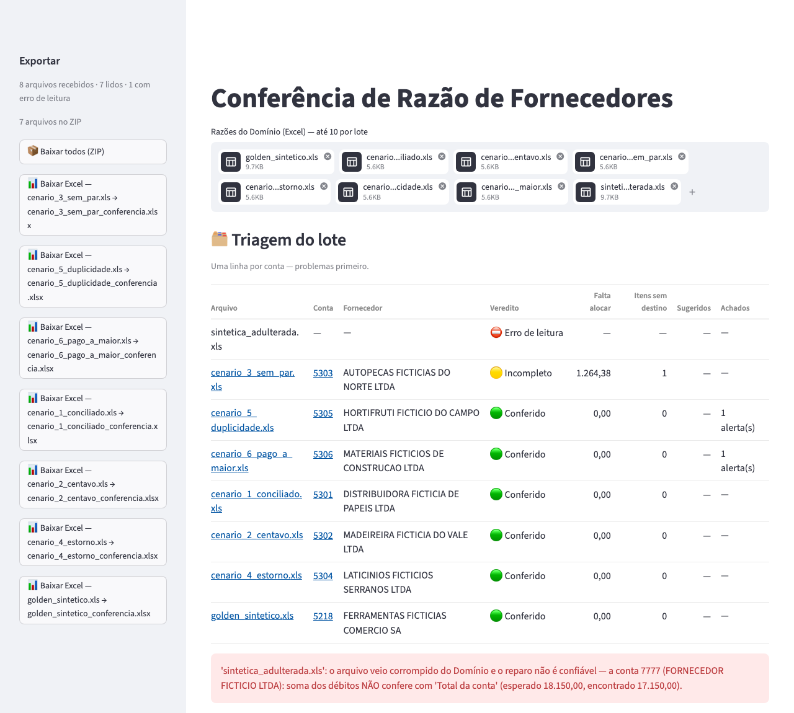
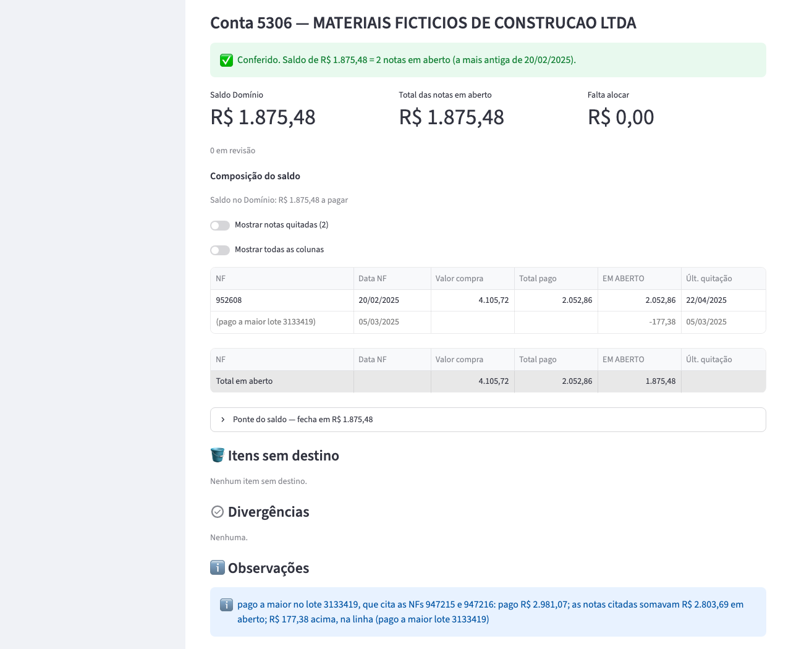
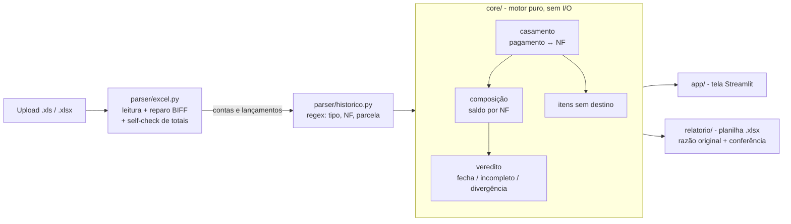

# Conciliador de Razão de Fornecedores

Conferência da razão de fornecedores exportada do Domínio: nota a nota, contra o saldo da conta.

[](https://github.com/leirosjose/conciliador-razao/actions/workflows/ci.yml)


## O que é

Substitui a conferência feita à mão no Excel. Lê a razão de fornecedores exportada do sistema contábil Domínio
(`.xls` ou `.xlsx`), liga cada pagamento à nota fiscal que ele quita, compõe o saldo em aberto nota a nota e diz se
a composição bate com o saldo final da conta. O que o motor não consegue decidir com certeza vai para uma lista de
itens sem destino, nunca para um palpite. Aceita até 10 razões por lote e devolve uma planilha de conferência por
arquivo, ou todas num ZIP.

| | |
|---|---|
|  |  |
| Item sem destino: o valor, o motivo e o histórico integral | Planilha exportada: a razão original e a conferência, com os números da tela |
|  |  |
| Triagem de um lote de 8 razões, problemas primeiro | Pagamento acima das notas citadas: a sobra vira linha própria |

## Arquitetura



- **Motor puro:** `core/` não conhece arquivo, tela nem planilha. Recebe lançamentos e devolve composição, itens sem
  destino e achados; por isso é testado sem Excel e sem navegador.
- **Vocabulário fora do motor:** os padrões do histórico moram em `parser/historico.py`. Um padrão novo é uma linha
  numa lista, não código no core.
- **Tela e planilha espelhadas:** `app/` e `relatorio/` não recalculam a composição. Totais, saldo e diferença chegam
  prontos do motor, e as duas usam as mesmas funções de texto. A única conta da casca é a materialidade (quanto os
  maiores itens sem destino pesam na diferença), isolada em `app/materialidade.py`.

A leitura escolhe `.xls` (BIFF) ou `.xlsx` pela assinatura do arquivo, não pela extensão. Antes do motor, os totais
de débito e crédito, o saldo final e o saldo corrente linha a linha são conferidos contra o que a própria razão
declara. Os cenários e o resultado esperado de cada um estão em [`tests/GOLDEN.md`](tests/GOLDEN.md).

## Problemas reais e como resolvi

- **O Excel do Domínio que não abre.** Alguns `.xls` saem do exportador com o ponteiro da planilha (record
  BOUNDSHEET) apontando para células órfãs, e o `xlrd` falha com `Expected BOF record`. Solução: extrair o stream
  BIFF do container OLE, realinhar cada ponteiro ao início real da planilha e reabrir. Como reparar pode esconder
  defeito, a leitura reparada passa pelo mesmo self-check de totais; se não bater, o arquivo é recusado. Prova: um
  `.xls` corrompido do jeito exato que o exportador corrompe e um adulterado que repara mas não fecha.
- **`Decimal` × `float`.** As células trazem dinheiro em ponto flutuante, e a composição feita à mão no Excel carrega
  artefatos como `1440.090000000001`. Todo valor entra como `Decimal(str(valor))` arredondado ao centavo, e nenhuma
  conta de dinheiro passa por `float`. Na aba da razão original o número cru fica como está: cópia fiel é cópia fiel.
- **Histórico escrito à mão.** `PAGTO REF. NF.:  618204.2`, `NFS:947215 E NF 947216`, `IRRF RETIDO S/ NF 3333`.
  Solução: biblioteca de padrões declarativa e ordenada, do mais específico para o menos. Duas notas no mesmo
  histórico não viram uma escolha: o casamento por soma decide, ou o item fica sem destino. Histórico sem padrão
  conhecido nunca some: vira item sem destino.
- **Devolução que virava compra de valor zero.** O dinheiro sumia e o veredito acusava a composição em vez do
  lançamento. Solução: invariante de lugar. Todo lançamento termina em exatamente um lugar (composição, itens sem
  destino, par de estorno ou fora da composição por decisão de quem confere) e do lado certo. A invariante roda sobre
  os resultados dos testes (`tests/test_invariante_lugar.py`).
- **Casamento errado é pior que item sem destino.** Um pagamento ligado à nota errada faz a composição parecer certa
  e esconde o problema. Solução: o casamento só liga o que tem regra explícita, a sugestão do motor só marca uma
  opção (não move dinheiro) e o veredito **Incompleto** mostra que a diferença é exatamente o que está sem destino.
- **Dependência nova que derrubava os testes da tela.** Uma versão nova do `pyarrow`, transitiva do Streamlit,
  derrubava o `AppTest` com SIGSEGV. Solução: `requirements.txt` fixa as versões, inclusive as transitivas binárias;
  subir versão é de propósito e com a suíte.

## Como rodar

```bash
git clone https://github.com/leirosjose/conciliador-razao.git
cd conciliador-razao
docker compose up
```

Abra **http://localhost:8501** (ou http://127.0.0.1:8501, se localhost não abrir) e envie
`exemplos/razao_exemplo_sem_par.xls`. Requisito: Docker. Todos os dados do repositório são sintéticos: empresas e
fornecedores com "FICTICIA" no nome, CNPJ 00.000.000/0000-00, notas, valores e históricos inventados.

O exemplo é a razão de uma conta com 7 lançamentos. A tela mostra:

- veredito **Incompleto**: a composição não bate com o saldo, e a diferença está explicada;
- **Total das notas em aberto R$ 3.419,65** (NF 889457, sem pagamento) × **Saldo Domínio R$ 2.155,27**;
- **Falta alocar R$ 1.264,38** = exatamente 1 item sem destino: um boleto pago sem número de nota e com valor que não
  é parcela de nota nenhuma;
- a NF 886120 quitada por duas parcelas que citam o número, e o saldo anterior quitado pela nota antiga.

<details>
<summary>Sem Docker (Python 3.11 ou mais novo)</summary>

```bash
python3 -m venv .venv
.venv/bin/pip install -r requirements.txt
.venv/bin/streamlit run app/main.py --server.address 127.0.0.1 --server.headless true
```

</details>

## Testes e CI

Dependências: `.venv/bin/pip install -r requirements-dev.txt` e, para as suítes de navegador,
`.venv/bin/playwright install chromium`.

| suíte | testes | precisa de |
|---|---|---|
| padrão (`.venv/bin/python -m pytest`) | 1.463 | nada |
| tela no navegador (`CONCILIADOR_TESTE_NAVEGADOR=1`) | 30 | Chromium |
| exemplo pela tela (`CONCILIADOR_URL=http://127.0.0.1:8501`) | 1 | app no ar e Chromium |

O CI roda lint (ruff), a suíte padrão em Python 3.11 e 3.13 e o build da imagem Docker, a cada push e pull request.

## Stack e decisões

- Python 3.13 (testado também em 3.11), Streamlit, xlrd e olefile para ler e reparar o `.xls`, openpyxl para o
  `.xlsx` e a planilha exportada, pandas na tela, pytest e Playwright, Docker.
- **`Decimal` de ponta a ponta.** A tolerância de centavos do casamento é uma regra explícita, não um efeito do
  arredondamento.
- **Nunca forçar a composição a fechar.** Se a soma não bate com o saldo, o veredito diz e mostra a diferença.
- **Casamento em ordem fixa, do mais seguro para o menos:** número da nota no histórico; pagamento que cita várias
  notas e paga a soma delas (se paga acima, as notas quitam e a sobra vira linha própria); por valor, só quando é
  inequívoco. Empate entre notas tem desempate explícito (a única em aberto ou a mais antiga), com marcador na linha;
  só o empate que sobra vai para os itens sem destino.
- **Conferir a leitura.** Se os totais não batem com o que a razão declara, o veredito é **Divergência**, com o
  esperado e o encontrado; nada é ajustado para fechar.
- **Entrada em Excel.** É o formato estruturado que o Domínio exporta; o sistema não lê PDF.
- **A tela mostra fatos.** Sem instrução ao usuário e sem citar pessoa; um teste varre os textos da tela e da planilha
  (`tests/test_regra_de_tela.py`).
- **Golden sintético.** `tests/fixtures/golden_sintetico.xls` e 6 cenários com resultado declarado em
  `tests/GOLDEN.md`, gerados por `tests/fixtures/gerar_sinteticas.py`: rodar duas vezes gera os mesmos bytes.
- **Docker enxuto.** Usuário não-root, healthcheck e porta publicada só em 127.0.0.1.

## Desenvolvido com IA generativa

A arquitetura, as regras de negócio e a validação são minhas.

A implementação foi feita com inteligência artificial generativa (Claude Code e Codex), sob minha revisão:

- **Trava:** a suíte e o resultado declarado de cada cenário em `tests/GOLDEN.md`; o teste compara, não recalcula;
- **Regras como teste:** a invariante de lugar e a varredura dos textos da tela rodam na suíte padrão;
- **Tela de verdade:** um teste opcional sobe o exemplo deste README num navegador real e confere os números.

Este repositório público usa só dados sintéticos:

- **Fonte de dados:** as razões saem de um gerador determinístico, com nomes "FICTICIA" e CNPJ zerado;
- **Verificação:** gitleaks e uma varredura de nomes e documentos antes de cada commit.

---

Copyright (c) 2026 José Leiros. Todos os direitos reservados.
